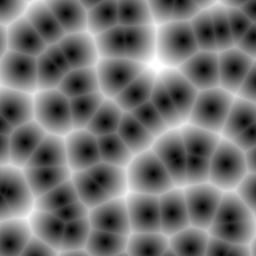
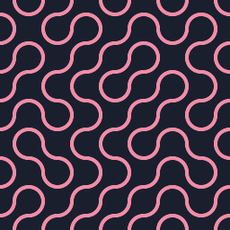
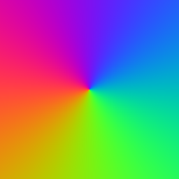
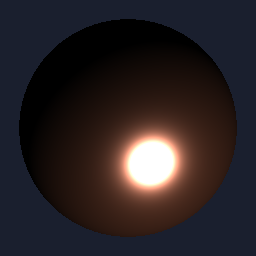
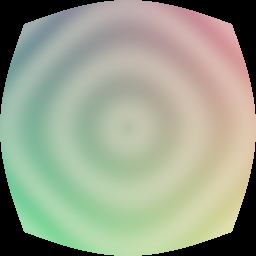

<p align="center">
  <picture>
    <source media="(prefers-color-scheme: dark)" srcset="docs/website/src/assets/logo.svg">
    
  </picture>
</p>

<p align="center"><strong>Universal GPU abstraction for Rust, JavaScript, Python, Swift, and Kotlin.</strong></p>

<p align="center">
  <a href="https://crates.io/crates/fragmentcolor"></a>
  <a href="https://www.npmjs.com/package/fragmentcolor"></a>
  <a href="https://pypi.org/project/fragmentcolor/"></a>
  <a href="https://docs.rs/fragmentcolor"></a>
  <a href="LICENSE.md"></a>
</p>

<p align="center">
  <a href="https://fragmentcolor.org/welcome">Get started</a> ·
  <a href="https://fragmentcolor.org/api">API reference</a> ·
  <a href="https://fragmentcolor.org/shaders">Shader library</a> ·
  <a href="https://fragmentcolor.org/demos">Demos</a>
</p>

Write a shader in WGSL or GLSL, set its uniforms by name, and render it. FragmentColor reads the shader to build the pipeline, bind groups, and buffers, so you write no setup code. It runs on Vulkan, Metal, DirectX 12, OpenGL, WebGL2, and WebGPU through [wgpu](https://wgpu.rs).

## Why FragmentColor

- **The shader is the source of truth.** Uniforms, textures, samplers, storage buffers, and push constants come from the shader itself. `shader.set("light.color", [1.0, 0.8, 0.6])` writes the field it names.
- **One API in five languages.** Rust, JavaScript, Python, Swift, and Kotlin share the same calls. CI builds every documented example in all five languages, so the docs and the bindings stay in step.
- **A shader library built in.** Over 200 WGSL functions for noise, distance fields, color, lighting, and post effects compose into your shader by name.
- **Passes and compute.** Chain render and compute passes, render into textures, and read the results back.
- **Native surfaces.** A window on desktop, a `<canvas>` on the web, a `CAMetalLayer` on iOS, and a `Surface` on Android.

## Quick start

Add the crate to `Cargo.toml`:

```toml
[dependencies]
fragmentcolor = "0.12.6"
```

Then render a shader. Its one uniform, `color`, is ready to set as soon as the shader builds:

```rust
use fragmentcolor::{Renderer, Shader};

let renderer = Renderer::new();
let target = renderer.create_texture_target([800, 600]).await?;

let shader = Shader::new(r#"
    @group(0) @binding(0)
    var<uniform> color: vec4<f32>;

    @vertex
    fn vs_main(@builtin(vertex_index) index: u32) -> @builtin(position) vec4<f32> {
        var pos = array<vec2<f32>, 3>(
            vec2<f32>(-1.0, -1.0),
            vec2<f32>( 3.0, -1.0),
            vec2<f32>(-1.0,  3.0)
        );
        return vec4<f32>(pos[index], 0.0, 1.0);
    }

    @fragment
    fn fs_main() -> @location(0) vec4<f32> {
        return color;
    }
"#)?;

shader.set("color", [1.0, 0.2, 0.4, 1.0])?;
renderer.render(&shader, &target)?;
```

### The same calls in every language

With `source` holding the WGSL above:

<details>
<summary>JavaScript</summary>

```js
import { Renderer, Shader } from "fragmentcolor";

const renderer = new Renderer();
const target = await renderer.createTextureTarget([800, 600]);

const shader = new Shader(source);
shader.set("color", [1.0, 0.2, 0.4, 1.0]);
renderer.render(shader, target);
```

</details>

<details>
<summary>Python</summary>

```python
from fragmentcolor import Renderer, Shader

renderer = Renderer()
target = renderer.create_texture_target([800, 600])

shader = Shader(source)
shader.set("color", [1.0, 0.2, 0.4, 1.0])
renderer.render(shader, target)
```

</details>

<details>
<summary>Swift</summary>

```swift
import FragmentColor

let renderer = Renderer()
let target = try await renderer.createTextureTarget([800, 600])

let shader = try Shader(source)
try shader.set("color", [1.0, 0.2, 0.4, 1.0])
try renderer.render(shader, target)
```

</details>

<details>
<summary>Kotlin</summary>

```kotlin
import org.fragmentcolor.*

val renderer = Renderer()
val target = renderer.createTextureTarget(listOf(800, 600))

val shader = Shader(source)
shader.set("color", listOf(1.0f, 0.2f, 0.4f, 1.0f))
renderer.render(shader, target)
```

</details>

### Draw into a window

Swap the texture target for a window target. Each platform passes its own surface:

| Language   | Surface                   | Call                                     |
| ---------- | ------------------------- | ---------------------------------------- |
| Rust       | a `winit` window          | `renderer.create_target(window).await?`  |
| JavaScript | a `<canvas>`              | `await renderer.createTarget(canvas)`    |
| Python     | a `RenderCanvas`          | `renderer.create_target(canvas)`         |
| Swift      | a `CAMetalLayer`          | `try await renderer.createTarget(layer)` |
| Kotlin     | an `android.view.Surface` | `renderer.createTarget(surface)`         |

## Compose shaders from the library

Name the functions you need next to your own source. The parts join into one module before it compiles:

```rust
let shader = Shader::new([
    "sdf2d/circle",   // fn circle(p: vec2<f32>, r: f32) -> f32
    "noise/simplex2", // fn simplex2(v: vec2<f32>) -> f32
    my_shader,        // your entry points, which call both
])?;
```

Native builds carry the library in the binary, so this works offline. On the web, `await Shader.fetch([...])` loads the parts from fragmentcolor.org.

|  |  |  |  |  |  |
| :-: | :-: | :-: | :-: | :-: | :-: |
| `noise/worley2` | `sdf2d/heart` | `pattern/truchet` | `gradient/palette_iq` | `lighting/cook_torrance` | `postfx/crt_curvature` |

[Browse the shader library](https://fragmentcolor.org/shaders) for every function and its preview.

## Install

| Language   | Install                                                                                                      |
| ---------- | ------------------------------------------------------------------------------------------------------------ |
| Rust       | `cargo add fragmentcolor`                                                                                    |
| JavaScript | `npm install fragmentcolor`                                                                                  |
| Python     | `pip install fragmentcolor`                                                                                  |
| Swift      | Add `https://github.com/vista-art/fragmentcolor` as a Swift Package dependency                              |
| Kotlin     | Download `fragmentcolor-<version>.aar` from the [latest release](https://github.com/vista-art/fragmentcolor/releases/latest) |

The [JavaScript](./platforms/web/README.md) and [Python](./platforms/python/README.md) packages have READMEs of their own.

## Try the examples

The `examples/rust` crate holds runnable examples, from a single triangle to a compute shader that moves a million particles:

```bash
cargo run -p fce --example triangle
cargo run -p fce --example particles_compute
./fc example    # pick one from the list
```

## Platform support

Platform support follows upstream [wgpu](https://github.com/gfx-rs/wgpu):

| API    | Windows      | Linux/Android   | macOS/iOS | Web (wasm)  |
| ------ | ------------ | --------------- | --------- | ----------- |
| Vulkan | ✅           | ✅              | 🌋        |             |
| Metal  |              |                 | ✅        |             |
| DX12   | ✅           |                 |           |             |
| OpenGL | 🆗 (GL 3.3+) | 🆗 (GL ES 3.0+) | 📐        | 🆗 (WebGL2) |
| WebGPU |              |                 |           | ✅          |

✅ = First Class Support  
🆗 = Downlevel/Best Effort Support  
📐 = Requires the [ANGLE](http://angleproject.org/) translation layer (GL ES 3.0 only)  
🌋 = Requires the [MoltenVK](https://vulkan.lunarg.com/sdk/home#mac) translation layer

## Learn more

- [Getting started](https://fragmentcolor.org/welcome) and the [API reference](https://fragmentcolor.org/api), with every example in all five languages
- [Roadmap](./ROADMAP.md) for what comes next, and the [Changelog](./CHANGELOG.md) for what changed
- [Contributing](./CONTRIBUTING.md) for building, testing, and the release process

## License

FragmentColor is released under the [MIT License](./LICENSE.md).
