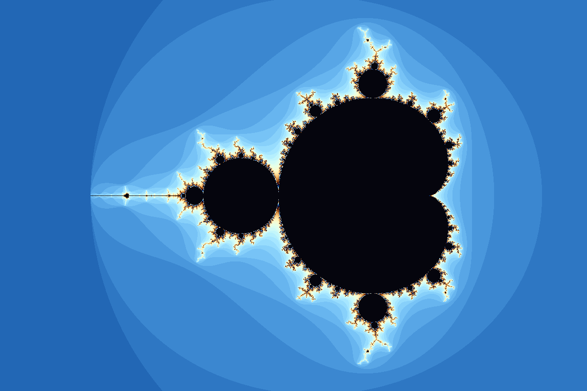

import Snippet from "../../../components/Snippet.astro";
import Demo from "../../../components/Demo.astro";
import Math from "../../../components/Math.astro";

The Mandelbrot set comes from one rule. It takes a complex number <Math tex="c" />, starts from <Math tex="z_0 = 0" />, and repeats

<Math block tex="z_{n+1} = z_n^2 + c" />

over and over. The numbers it produces form the **orbit** of 0 for that <Math tex="c" />.

A complex number is a point in the plane: <Math tex="x + yi" /> is the point <Math tex="(x, y)" />. Squaring it gives <Math tex="(x^2 - y^2) + 2xy\,i" />, which turns one step of the rule into two lines of ordinary arithmetic. For some values of <Math tex="c" /> the orbit stays small forever. Others grow without limit, and any orbit that gets farther than 2 from the origin never returns. Every <Math tex="c" /> whose orbit stays small belongs to the **Mandelbrot set**.

Coloring each point of the plane by how many steps its orbit takes to escape draws a coastline of bulbs, spirals and filaments, with small, slightly distorted copies of the whole set at every magnification.

This tutorial builds a viewer for it in four steps. A single picture on the CPU comes first. Next, the same computation moves to the GPU, where rounding breaks the picture near `1e-6`. K. I. Martin's perturbation method then reaches `1e-35`, and a final step passes `1e-1000` in real time. Those numbers measure the height of the view: at `1e-1000`, the canvas shows a strip of the plane <Math tex="10^{-1000}" /> units tall.

## A shape nobody could see

Around 1918, Pierre Fatou and Gaston Julia studied what repeating a function like this one does to each starting point. They had proofs and pencils. A picture was out of reach: a single image of the set takes millions of these steps, and a person with paper might manage a few dozen points in an afternoon.

In 1978, Robert Brooks and Peter Matelski printed a rough picture of the set, one character at a time.

Two years later, computer plots by Benoit Mandelbrot made it famous, and Adrien Douady and John Hubbard, who proved that the set is connected, named it after him. Yet the shape is older than everyone in this story. Its spirals follow from <Math tex="z^2 + c" /> the way the primes follow from multiplication, so they existed before anyone wrote the rule down. People discovered the set; computers made it visible.

## Running the code

Each step is a complete program in five languages, in [`docs/tutorials/infinite-zoom`](https://github.com/vista-art/fragmentcolor/tree/main/docs/tutorials/infinite-zoom). The Rust versions are examples of the repository's `fce` crate, so `cargo run --release -p fce --example tutorial_infinite_zoom_one_image` runs the first one. In a project of your own they need `fragmentcolor` with its `winit` feature, plus `winit` 0.30, `parking_lot`, `env_logger`, `bytemuck`, `image`, `num-bigint` and `num-traits`.

From step 2 on, the other four languages split each program into two functions: `setup`, called once, and `frame`, called on every display refresh with the time, the canvas size and the pointer position in pixels. The canvases on this page call the JavaScript ones, and the [playground](/welcome/playground/)'s `index.js` tab shows a page that does the same. For Python, `docs/tutorials/infinite-zoom/host.py` opens a window (`pip install fragmentcolor rendercanvas glfw`). Swift and Kotlin apps call the two functions from their render loop; steps 3 and 4 in Swift also need the [BigInt](https://github.com/attaswift/BigInt) package.

## Step 1: one image on the CPU

Every pixel stands for one value of <Math tex="c" />. The program iterates the orbit for that <Math tex="c" /> and counts the steps until it leaves the disk of radius 2; a point still inside after `LIMIT` steps counts as part of the set. Comparing the squared distance with 4 answers the same question without a square root:

<Snippet file="infinite-zoom/01-one-image/example.rs" region="escape" />

Mapping each pixel to its <Math tex="c" />, and each count to a color, takes a few more lines:

<Snippet file="infinite-zoom/01-one-image/example.rs" region="image" />

A color here is three numbers from 0 to 255, for red, green and blue. To turn a count into one, the program feeds it to a **cosine palette**, <Math tex="0.5 + 0.5\cos\big(2\pi(t + d)\big)" />, once per channel. <Math tex="t" /> grows by 0.02 with every step of the orbit, and the phase <Math tex="d" /> is 0, 0.1 and 0.2 for the three channels. Each cosine sweeps between dark and bright as <Math tex="t" /> grows, and the offsets keep the channels from peaking together, which yields a cycle of hues. Pixels with equal counts share a color, so each band of equal count shows as a stripe around the set:

<Snippet file="infinite-zoom/01-one-image/example.rs" region="color" />

Rust writes the result to `mandelbrot.png`; Python, Swift and Kotlin write `mandelbrot.ppm`, and JavaScript draws into the first `<canvas>` on its page. An optimized Rust build takes about a quarter of a second for these 960,000 pixels. Smooth motion needs thirty to sixty images per second, and deeper views need far more steps per pixel.

## Step 2: the same loop on the GPU

A GPU runs one small program on thousands of pixels in parallel, which suits this problem well. That program is a **fragment shader**: a function the GPU calls once for each pixel a triangle covers, written in WGSL, the shading language of WebGPU. Its numbers are `f32`, 32-bit floats. Complex numbers become `vec2<f32>`, with the real part in `x` and the imaginary part in `y`:

<Snippet file="infinite-zoom/02-on-the-gpu/example.rs" region="shader" />

`struct View` holds the shader's **uniforms**: inputs that the **host**, the program around the shader, sets from the CPU, the same for every pixel. Four details are new:

- The escape radius is 256 instead of 2, and `65536` is its square. Past that radius, each step roughly squares the orbit's size, which doubles <Math tex="\log_2 |z|^2" />. `log2(log2(size2) / 16)` runs from 0, for an orbit that only just crossed the radius, to 1, for one that crossed it a whole step earlier (16 is <Math tex="\log_2 65536" />). Subtracting it from `n + 1` gives a count that changes smoothly from pixel to pixel, which blends the stripes of step 1 into gradients.
- `palette_iq` is the cosine palette from step 1, with its four constants as arguments.
- `print_depth` writes the view's height, as `1e-<depth>`, in the bottom left corner.
- `vs_main` places one triangle large enough to cover the whole canvas, since the fragment shader only runs where a triangle is. The GPU clips the parts outside.

Constants at the top set the target and the pace. `TARGET` is a spiral in Seahorse Valley, the crease between the big cardioid and the round bulb on its left:

<Snippet file="infinite-zoom/02-on-the-gpu/example.rs" region="constants" />

The host builds the shader from a list of sources and joins them into one program. `"gradient/palette_iq"` is a **slug**: the name of a function in FragmentColor's [shader library](/shaders/). `LABEL` holds `print_depth`, and `SHADER` is the code above. Rust's `Shader::new` finds slugs in a copy of the library inside the crate, while JavaScript's `Shader.fetch` may download them and returns a promise. To reach a uniform, `set` takes its name: `view.center` is the `center` field of the `var<uniform>` called `view`.

<Snippet file="infinite-zoom/02-on-the-gpu/example.rs" region="setup" />

`zoom` counts doublings. Adding 1 to it halves the view's height, which is <Math tex="\mathit{START} \cdot 2^{-\mathit{zoom}}" />. Each frame, `steer` moves `zoom` by `SPEED` doublings per second of elapsed time, and the shader receives the new height and depth:

<Snippet file="infinite-zoom/02-on-the-gpu/example.rs" region="frame" />

On its own, `steer` runs the zoom from the whole set down to a view <Math tex="10^{-\mathit{DEPTH}}" /> tall and back. While the pointer moves over the canvas, its vertical position picks the depth instead, deepest at the top:

<Snippet file="infinite-zoom/02-on-the-gpu/example.rs" region="steer" />

<Demo file="infinite-zoom/02-on-the-gpu/example.rs" />

The spiral turns grainy near `1e-5`. By `1e-6`, it has fallen apart into rectangles.

### Seven digits

An `f32` stores a number as 24 significant bits, about seven decimal digits, times a power of two called its **exponent**. Ordinary values have exponents from <Math tex="2^{-126}" /> to <Math tex="2^{127}" />, which covers everything from about <Math tex="10^{-38}" /> to <Math tex="10^{38}" />. Seven digits are all it ever has, though. Near <Math tex="-0.74" />, neighboring `f32` values are about `6e-8` apart along the real axis, and near <Math tex="0.13" /> about `1.5e-8` apart along the imaginary one. In a view `1e-6` tall, a pixel is far smaller than either gap. Blocks of pixels, dozens wide and a quarter as tall, round to the same <Math tex="c" /> and get the same color.

Multiplying keeps all seven digits: <Math tex="3 \times 10^{-30} \cdot 0.74" /> is as precise as its inputs. Adding a tiny number to a large one is where digits vanish, and in <Math tex="-0.74 + 3 \times 10^{-30}" /> the small part disappears completely.

Years ago I wrote a Mandelbrot explorer on CodePen that ran on the CPU, with JavaScript's 64-bit numbers. It drew until about `1e-13`, then showed the same blocks. Its WebGL version on Shadertoy ran much faster and failed sooner, around `1e-5`, because WebGL shaders only have 32-bit floats. WGSL has no 64-bit floats either. More bits would only delay the problem anyway: any fixed number of digits fails at some depth, because the set keeps its detail at every scale.

## Step 3: one careful orbit for every pixel

In 2013, K. I. Martin released SuperFractalThing, a Java program for deep zooms, and explained its speed in a two-page paper, [SuperFractalThing Maths](http://www.superfractalthing.co.nf/sft_maths.pdf). The original site is gone; the [Internet Archive keeps a copy of the paper](https://web.archive.org/web/20130701075021/http://www.superfractalthing.co.nf/sft_maths.pdf). Martin's idea is **perturbation**: compute one orbit with all the digits it needs, then describe each pixel's orbit by its small difference from that one.

Here the notation changes. Capital <Math tex="Z_n" /> is the orbit of one carefully chosen point, the **reference**, and from now on <Math tex="c" /> means that point. A pixel lies a small offset <Math tex="\delta" /> away, at <Math tex="c + \delta" />, with orbit <Math tex="Z_n + z_n" />. Lowercase <Math tex="z_n" /> is now the pixel's difference from the reference. Both orbits follow the rule:

<Math block tex="Z_{n+1} + z_{n+1} = (Z_n + z_n)^2 + c + \delta = Z_n^2 + 2 Z_n z_n + z_n^2 + c + \delta" />

<Math block tex="Z_{n+1} = Z_n^2 + c" />

Subtracting the second line from the first leaves the rule for the difference:

<Math block tex="z_{n+1} = 2 Z_n z_n + z_n^2 + \delta" />

This rule never adds a tiny number to a large one. <Math tex="Z_n" /> only multiplies <Math tex="z_n" />, which keeps its digits, and the remaining sums are between small numbers that each keep their full precision in an `f32`. The shader adds <Math tex="Z_n + z_n" /> only to test whether the pixel escaped, where a little rounding doesn't change the answer. Each pixel needs two inputs: its offset and the reference orbit. All the precision goes into that one orbit, computed once.

### The reference

This reference is a **Misiurewicz point**: after 24 steps, its orbit enters a cycle of period 2 and repeats it forever. Around such a point the set looks nearly the same at every scale, a spiral inside a spiral, so the zoom always has structure to show. Sixteen digits locate this one. Newton's method, in `refine`, improves them to as many as the deepest view needs, each round doubling the number of correct ones; on a first read, `refine` can stay a black box.

No float holds that many digits. On the CPU, the reference uses integers of any size: `BigInt` in JavaScript, the `num-bigint` crate in Rust, `int` in Python, `BigInteger` in Kotlin and the BigInt package in Swift. A `BigInt` value `n` stands for <Math tex="n / 2^{\mathit{bits}}" />. A product of two such values has the factor <Math tex="2^{\mathit{bits}}" /> twice, and a right shift by `bits` removes one of them. `bits` is the deepest view's depth in binary digits plus 80 spare ones, which keeps rounding far below one pixel.

The host rounds each <Math tex="Z_n" /> to `f32` as it goes. Rounding inside the integers grows along the orbit like the derivative <Math tex="dZ_n/dc" />, kept in `dr` and `di`, and the loop ends before that error reaches <Math tex="2^{-40}" />.

<Snippet file="infinite-zoom/03-perturbation/example.rs" region="reference" />

`setup` (`Zoom::new` in Rust) builds the orbit once and stores it in a **storage buffer**, GPU memory that the shader reads as an array, sized by an `ORBIT` constant written ahead of the shader's own source:

<Snippet file="infinite-zoom/03-perturbation/example.rs" region="setup" />

In the shader, `dc` is the offset <Math tex="\delta" />. A second counter, `m`, is the pixel's position along the reference orbit; it keeps pace with the iteration count `n` until a rebase, explained below, separates the two. Each step updates `z` with the rule above. The reference joins it only for the tests, which compare the full value `orbit[m] + z` with the escape radius and with `z` itself:

<Snippet file="infinite-zoom/03-perturbation/example.rs" region="shader" />

### Glitches and rebasing

Martin's method has one weak spot. When a pixel's orbit passes close to 0 and the reference doesn't, <Math tex="Z_n" /> and <Math tex="z_n" /> nearly cancel. With <Math tex="Z_n = 0.5" /> and <Math tex="z_n = -0.4999999" />, the pixel's true value is <Math tex="10^{-7}" />, and only the last of the seven digits survives the subtraction. Every later step depends on that one digit. Whole regions come out as flat blobs called **glitches**, most often near the small copies of the set, where many orbits pass close to 0. Pauldelbrot, on Fractal Forums, found a test for them: a pixel has lost its digits once

<Math block tex="|Z_n + z_n| < 10^{-3}\, |Z_n|" />

Programs used it to find glitched pixels and render them again from a second reference.

In 2021 Zhuoran proposed a simpler fix, **rebasing**. As soon as the pixel is closer to 0 than to the reference, the shader sets `z` to the pixel's full value and `m` to 0. The difference rule only needs a point of the reference orbit that the pixel is close to, and at <Math tex="Z_0 = 0" /> the difference equals the full value. From there the pixel follows the start of the same orbit with its digits intact. That is the last `if` in the shader, which also catches a pixel that reaches the end of the reference orbit before it escapes. Rebasing costs one comparison per step and makes Pauldelbrot's test unnecessary, which is why the test appears here only as history.

<Demo file="infinite-zoom/03-perturbation/example.rs" />

This zoom moves twice as fast as the last one. Perturbation takes it past `1e-15` and on past `1e-30`; somewhere around `1e-35`, the picture turns into a single flat color.

### The smallest exponent

The smallest ordinary `f32` is <Math tex="2^{-126}" />, about `1.2e-38`. Below it come **denormal** values, which give up digits to reach down to about `1.4e-45`, and many GPUs flush them to 0 for speed. A view `1e-35` tall on a canvas about 800 pixels high has pixels near `1e-38` wide. Once one pixel spans less than `1.2e-38`, `view.pixel` reads as 0 on such a GPU, every <Math tex="\delta" /> is 0, and every pixel follows the reference.

This time the limit is the exponent, and the digits still have room. An `f64` would extend the range to about `1e-308`, and the spiral continues far beyond that.

## Step 4: past every exponent

Two problems stand between step 3 and `1e-1000`. The differences have to stay inside the range of an `f32`. Deeper views also need more iterations: near `1e-1000`, a pixel by this spiral takes about 32,000 steps to escape.

### Keep the exponent separately

Pauldelbrot described the first fix as **rescaled iterations**. Each difference becomes a pair: a `vec2<f32>` `w` near 1, and an integer exponent `s`, with <Math tex="z = w \cdot 2^s" />. Dividing the rule from step 3 by <Math tex="2^s" /> gives

<Math block tex="w_{n+1} = 2 Z_n w_n + 2^s\, w_n^2 + 2^{-s}\,\delta" />

Only the factor <Math tex="2^s" /> and the scaled offset <Math tex="2^{-s}\delta" /> can leave the range of an `f32`. When they do, they are negligible compared with <Math tex="2 Z_n w_n" />, and rounding them to 0 loses nothing, except right after a rebase. The shader keeps them in `unit` and `offset` and recomputes both only when `s` changes. Three more details complete the loop:

- Whenever `w` grows past `65536` or shrinks below `1/65536`, the shader moves a power of two from `w` into `s`. WGSL's `frexp` splits a number into its digits and its power of two, and `ldexp` multiplies by a power of two; the `scale` helper wraps `ldexp`.
- Right after a rebase, <Math tex="Z_0 = 0" /> and the first term vanishes. The `m == 0u` branch computes that step from the square and the offset alone and picks a new `s` for the result.
- The pixel's offset arrives in the same form, as a `vec2<f32>` `d` times <Math tex="2^e" />, where `e` is `view.exponent`.

### Skip what every pixel shares

Martin's paper also has the second fix. The first steps of the rule from step 3, starting from <Math tex="z_0 = 0" />, show a pattern:

<Math block tex="z_1 = \delta, \qquad z_2 = 2 Z_1 \delta + \delta^2 + \delta = (2 Z_1 + 1)\,\delta + \delta^2" />

Each step multiplies and adds powers of <Math tex="\delta" />, which makes <Math tex="z_n" /> a polynomial in <Math tex="\delta" />. For thousands of iterations, <Math tex="\delta" /> is so small that the first three terms hold nearly all of it:

<Math block tex="z_n \approx A_n \delta + B_n \delta^2 + C_n \delta^3" />

Substituting this into the rule and collecting each power of <Math tex="\delta" /> gives coefficients that don't depend on the pixel:

<Math block tex="A_{n+1} = 2 Z_n A_n + 1, \quad B_{n+1} = 2 Z_n B_n + A_n^2, \quad C_{n+1} = 2 Z_n C_n + 2 A_n B_n" />

They start from <Math tex="A_0 = B_0 = C_0 = 0" />. <Math tex="A_n" /> is the derivative <Math tex="dZ_n/dc" /> from step 3, which is why it also measures the reference's rounding error. (Martin's paper starts its orbit at <Math tex="X_0 = c" />; its indices run one lower than these.) The CPU computes the coefficients once, alongside the orbit. They grow past the largest `f64`, so the CPU also stores each as a number and a separate power of two, like the shader's <Math tex="w \cdot 2^s" />: a small type called `Wide` in Rust, and arrays of `[re, im, exponent]` in JavaScript.

The series holds while the first term it drops, <Math tex="D_n \delta^4" />, stays small compared with <Math tex="A_n \delta" />. Its coefficient follows the same pattern, <Math tex="D_{n+1} = 2 Z_n D_n + 2 A_n C_n + B_n^2" />. For every iteration, the CPU records the widest radius at which that term stays below a ten-millionth of the first, close to the precision of an `f32`:

<Snippet file="infinite-zoom/04-deep-zoom/example.rs" region="series" />

Each frame, the host looks up the last iteration whose radius covers every pixel on screen. Every pixel starts there: the compute shader evaluates <Math tex="A\delta + B\delta^2 + C\delta^3" /> for its own <Math tex="\delta" /> and iterates the rest.

<Snippet file="infinite-zoom/04-deep-zoom/example.rs" region="frame" />

Near `1e-1000`, the series skips about 32,140 of roughly 32,270 steps. A typical pixel iterates the last 130 or so on its own, and that number barely changes at any measured depth deeper than `1e-6`.

### A compute pass and a render pass

The iteration moves into a **compute shader**: GPU code that runs as a grid of invocations and writes its results to memory, with no triangles involved. Splitting the work this way lets the expensive part run at a lower resolution on a large screen, while a cheap second shader turns its results into colors. `@workgroup_size(8, 8)` groups the invocations into tiles of 8 by 8, `global_invocation_id` tells each one which pixel it handles, and the host's `set_compute_dispatch` (`setComputeDispatch` in JavaScript) asks for enough tiles to cover the image. Each invocation writes one smooth count into a storage buffer, `counts`.

FragmentColor runs shaders in **passes**. A `Pass` holds shaders that draw or compute together, and `render` takes a list of passes and runs them in order; steps 2 and 3 handed `render` a lone `Shader`, which acts as a pass of its own. A pass whose shader has a `@compute` entry point runs as a compute pass. The second pass reads `counts` and colors each pixel, with the palette's density and phase and the inside color as its uniforms. Comments such as `// 100..5000` give the playground's sliders their ranges.

<Snippet file="infinite-zoom/04-deep-zoom/example.rs" regions={["shader", "present-shader"]} labels={["Compute", "Render"]} />

Before the loop, the compute shader takes a shortcut for wide views. Pixels inside the main cardioid and the bulb to its left never escape, and two quick formulas recognize them; `orbit[1]` holds the target's <Math tex="c" />, because <Math tex="Z_1 = 0^2 + c" />. `view.budget` caps the iterations after the series, in the role `LIMIT` played before.

Both passes declare `counts` with the same size, so FragmentColor binds one buffer to both. `setup` (`Zoom::new` in Rust) builds the reference with its series and both passes:

<Snippet file="infinite-zoom/04-deep-zoom/example.rs" region="setup" />

<Demo file="infinite-zoom/04-deep-zoom/example.rs" />

With the pointer at the top of the canvas, the view reaches `1e-1000` in about two seconds. The spiral there looks like the one at `1e-10`, which is why the zoom aims at a Misiurewicz point.

How close are these pictures to the truth? A slow `BigInt` computation of the same pixels matches the shader's counts to within a hundredth of an iteration at `1e-6`, `1e-45`, `1e-331` and `1e-999`. The only disagreements come from pixels whose count changes, sometimes by hundreds, when they move by a thousandth of a pixel; there, two different precisions rarely agree. On a laptop with an Apple M2, a 1920 by 1080 frame takes 21 to 31 milliseconds at each of a dozen depths from `1e-3` to `1e-999`, or 32 to 48 frames per second, and a smaller canvas runs at 60. Computing the reference for `1e-1000` takes under a second in JavaScript.

## Where to go next

The [playground](/welcome/playground/#mandelbrot) runs the last program with both shaders and the host open for editing, in any of the five languages. Some changes to try there:

- Set `TARGET` to another Misiurewicz point. Other preperiods and periods work, as long as the sixteen digits start close enough for Newton's method; from too far away, it can settle on a nearby point with a shorter preperiod or period.
- Raise `DEPTH`. Each extra power of ten adds about 32 orbit iterations of `BigInt` math in `setup`, on wider integers, and past roughly `1e-2000` the orbit needs a larger `ORBIT`. The GPU work per frame stays the same.
- Replace the series with **bilinear approximation**, from the same 2021 posts in which Zhuoran introduced rebasing. It also skips iterations after a rebase, and current deep zoom programs extend it. Claude Heiland-Allen's [Deep zoom theory and practice (again)](https://mathr.co.uk/blog/2022-02-21_deep_zoom_theory_and_practice_again.html) explains it.
